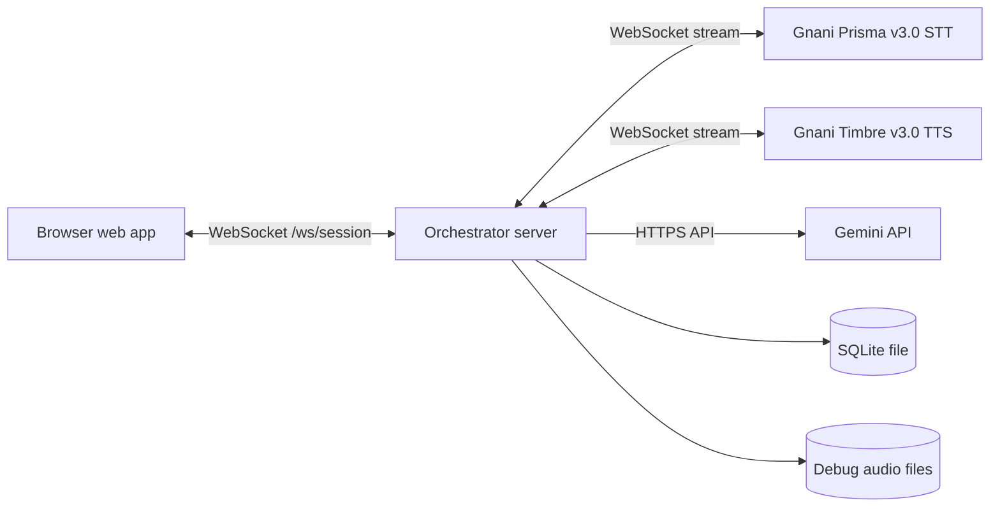

# ASHADhwani

**Speak the visit. Save the record. Spot the danger.**

ASHADhwani (ASHA Voice Visit Recorder) is a browser-based voice agent for ASHA health workers. The worker speaks her home-visit notes in English, Hindi or Kannada, and the agent turns them into a confirmed, structured visit record and a follow-up list. No typing.

Built by team Pixel Blox for the Gnani Voice Hackathon (theme: Healthcare, Voice Field Register for ASHA Workers).
**Team members:**
Sahithi Sangu 
Gnaneswari Gandham
Aishwarya Paidipati
Bharath Vankayala

---

## The problem

ASHA (Accredited Social Health Activist) workers log pregnancy, newborn and immunisation visits in paper registers and phone apps. They type on small screens while walking between houses. Data entry eats into visit time, and records arrive late or incomplete.

**How might a worker speak her visit notes in Hindi, Kannada or English with English code-mix, and get a correct record plus next actions before she reaches the next house?**

## What it does

1. **Listens.** The worker taps **Start session** and speaks. Audio streams over WebSocket to Gnani Prisma v3.0 speech-to-text. Code-mix and local health words ("TT injection", "ANC checkup", "IFA goli") are expected.
2. **Builds the record.** Gemini extracts the visit fields. The agent asks for one missing field at a time.
3. **Reads it back.** The agent speaks every field aloud in the worker's language, with the ID read character by character, using Gnani Timbre v3.0 text-to-speech.
4. **Accepts corrections.** The worker says "no, weight is 2.8 kilo", and only that field changes and is re-read.
5. **Saves only after a spoken "yes".** No record is saved without explicit voice confirmation.
6. **Reads the follow-up list.** Once saved, the agent reads the next actions: PHC referral if flagged, next visit date, and vaccinations due.
7. **Escalates danger signs.** If the worker mentions bleeding in pregnancy or high fever in a newborn, the agent immediately tells her, in her language, to refer to the PHC now, shows a red banner and flags the record.

The agent never gives diagnosis, treatment, medication, dosage or home-care advice. Every sentence it speaks comes from a reviewed, localized template. The language model never writes spoken text.

## Features

| Area | Detail |
|---|---|
| Languages | English, Hindi, Kannada, each with English code-mix. The agent language is fixed per worker profile. |
| Visit types | `pregnancy_anc`, `newborn_postnatal`, `immunisation` |
| Visit record | Beneficiary ID, name, visit type, weight (kg), next visit date, vaccinations due, notes, danger sign flag |
| Danger signs | Two only: DS-01 bleeding in pregnancy, DS-02 high fever in a newborn |
| Detection | A deterministic phrase matcher and a Gemini classifier run on every turn. A sign fires if either detects it, so the safety path works even when Gemini is down. |
| Resilience | Retries with backoff for the speech streams, drafts survive a stream drop, text always appears on screen even if audio fails |
| Privacy | Everything is stored locally in SQLite. Only audio (to Gnani) and transcript text (to Gemini) leave the machine. |

## How it works



The orchestrator is a custom FastAPI WebSocket server with an explicit state machine (`collecting`, `reading_back`, `awaiting_confirmation`, `saving`). It does not use a hosted agent platform.

## Quick start

**Prerequisites**
- Python 3.11 or later (Windows, macOS or Linux)
- Latest stable Chrome on desktop or Android, and a microphone
- A `GNANI_API_KEY` with Prisma v3.0 and Timbre v3.0 access for English, Hindi and Kannada
- A `GEMINI_API_KEY`

**Install and run**

```bash
python -m venv .venv
source .venv/bin/activate        # Windows: .venv\Scripts\activate
pip install -e .

cp .env.example .env             # Windows: copy .env.example .env
# edit .env and set GNANI_API_KEY and GEMINI_API_KEY

uvicorn app.main:app --host 127.0.0.1 --port 8000
```

Open `http://127.0.0.1:8000` in Chrome. Use `127.0.0.1` or `localhost` exactly, because the server checks the origin and the browser needs a secure context for the microphone.

**Use it**
1. Choose a worker profile from the dropdown. The profile sets the language for the whole session.
2. Tap **Start session** and allow microphone access.
3. Speak a visit, for example the beneficiary ID, name, visit type, weight, next visit date and vaccinations due.
4. Listen to the read-back. Say yes to save, or say what to change.
5. Tap **End session** when you are done.

**Android:** run `adb reverse tcp:8000 tcp:8000`, then open `http://127.0.0.1:8000` on the phone.

## Configuration

| File or variable | Purpose |
|---|---|
| `.env` | `GNANI_API_KEY`, `GEMINI_API_KEY`, optional `GEMINI_MODEL`, `DB_PATH` (default `data/app.db`), `DATA_DIR` (default `data`) |
| `config/app.yaml` | Every threshold: audio, VAD, timeouts, validation limits, retries, retention |
| `config/workers.yaml` | Pre-seeded worker profiles and their languages |
| `config/danger_lexicon.yaml` | Danger sign phrase lists |
| `config/health_glossary.yaml` | Health vocabulary sent to STT and Gemini |
| `locales/{en,hi,kn}.json` | Every spoken sentence and UI label |

## Project structure

```
backend/app/     FastAPI server, state machine, speaker, danger detection, Gnani and Gemini clients
frontend/        index.html, app.js, audio-worklet.js, styles.css (no framework, no CDN)
config/          app, workers, danger lexicon, health glossary
locales/         English, Hindi and Kannada strings
scripts/         purge_debug_data.py and the spike and benchmark scripts
tests/           unit, integration, golden, latency
docs/            gnani_contract.md
data/            runtime files, git-ignored (SQLite database, debug audio)
```

## Testing

```bash
pytest                      # unit and integration tests, no real services needed
```

The integration suite has one test for each of the ten acceptance scenarios (`AS-01` to `AS-10`), using fake speech and language-model adapters. Accuracy and latency are measured against scripted golden sets with real services:

```bash
python -m tests.golden.run --mode text     # needs GEMINI_API_KEY
python -m tests.golden.run --mode audio    # needs Gnani and Gemini keys
python -m tests.latency.run                # needs Gnani and Gemini keys
```

**Targets**

| Metric | Target |
|---|---|
| p95 latency, end of speech to first agent audio | ≤ 4,000 ms |
| Field accuracy, text input | ≥ 90% |
| Field accuracy, recorded audio | ≥ 80% |
| Danger sign recall | 30 of 30 |
| Danger sign false flags | ≤ 2 of 30 |
| Records saved without voice confirmation | 0 |

## Privacy and data

- The database, transcripts and debug audio contain health information and stay on the local machine.
- Debug audio and transcript rows older than 7 days (configurable) are removed with `python scripts/purge_debug_data.py`. Saved visits and follow-ups are never purged. Use `--dry-run` to preview.
- Application logs hold IDs and timings only, never transcript text, names or keys.
- Never commit `.env` or `data/`.

## Documentation

| Document | What it covers |
|---|---|
| [`scope.md`](scope.md) | What it is, who it is for, what is cut, success metrics |
| [`prd.md`](prd.md) | Requirements, dialogue rules, experience design, acceptance scenarios |
| [`spec.md`](spec.md) | Architecture, data model, interfaces, state machine, build steps |
| [`checklist.md`](checklist.md) | Task list and manual tests for the full build |
| [`AGENTS.md`](AGENTS.md) | Build, test and convention guidance for coding agents |
| [`docs/gnani_contract.md`](docs/gnani_contract.md) | Gnani API facts found in the Step 0 spike |

## Status and limits

The design baseline (v1.1) is complete. The implementation follows the 16 build steps in `spec.md` Section 12, tracked in `checklist.md`.

This is a hackathon prototype that runs locally on a developer machine. It is not a certified medical device and is not deployed. Out of scope: telephony, worker login, beneficiary registry lookup, editing a saved record, offline use and languages beyond English, Hindi and Kannada. Barge-in, session resume and a saved-records panel are planned after all required features pass.

## Team

Pixel Blox, Gnani Voice Hackathon.
