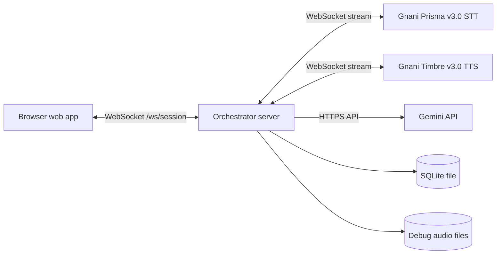
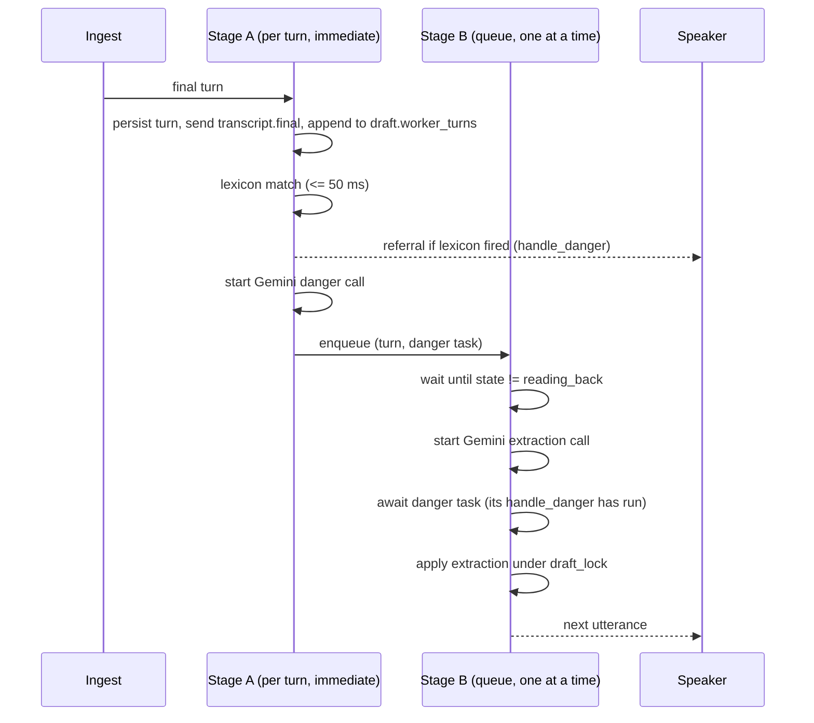

# Technical Specification: ASHA Voice Visit Recorder

| Field | Value |
|---|---|
| Project | Gnani Voice Hackathon |
| Document | `spec.md` |
| Version | 1.1 |
| Date | 2026-11-21 |
| Status | Baseline for implementation |
| Derived from | PRD v1.0 dated 2026-11-12, restructured into `scope.md`, `prd.md`, `spec.md`, `checklist.md` |
| Audience | Engineers and AI agents implementing the system |

---

## 1. Purpose and Conventions

This document defines how the system in `prd.md` is built. Sections 2 to 11 are reference. Section 12 is the build order, in 16 small steps (Step 0 to Step 15). Each step lists what to build, how to test it and when it is done. Build the steps in order.

**Conventions.**
- MUST and MUST NOT mark mandatory behavior. P0 and P1 have the meaning in `prd.md`.
- Requirement IDs (`FR-`, `NFR-`), decision IDs (`D-`), author defaults (`A-`), metrics (`M-`), acceptance scenarios (`AS-`), open items (`OI-`) and risks (`R-`) are defined in `prd.md` and `scope.md`.
- `SD-nn` are spec decisions defined in Section 3. They close ambiguities in PRD v1.0 and do not change any D-row.
- Field names, JSON keys, enum values, file names and config keys use `snake_case`. Python follows PEP 8.
- If this document and `prd.md` conflict, `prd.md` wins and the conflict is a defect in this document.
- Timestamps are UTC ISO 8601 text with milliseconds and a `Z` suffix (`2026-11-21T09:30:00.123Z`). Dates are `YYYY-MM-DD` text in `Asia/Kolkata`. IDs are UUID v4 text. Durations are integer milliseconds unless the name ends in `_s`.

---

## 2. Architecture

### 2.1 Context


### 2.2 Components
| Component | Responsibility |
|---|---|
| Browser web app | Worker dropdown, mic capture, audio playback, live transcript, live form, danger banner, follow-up list, status indicators. |
| Session handler | One instance per WebSocket session. Owns the draft, the state machine, the turn queue, the draft lock and the speaker. |
| Audio ingest | Receives audio frames, forwards them to STT, runs VAD, assembles turns. |
| Gnani STT adapter | Streams PCM16 audio to Prisma v3.0, emits partial and final transcript events. |
| Gnani TTS adapter | Sends text to Timbre v3.0, yields PCM16 audio chunks. |
| Speaker | Owns the agent utterance queue, priority preemption, playback timing and agent audio files. |
| Gemini client | Executes the extraction call and the danger classification call with structured JSON output. |
| Lexicon matcher | Deterministic danger sign detection, independent of Gemini. |
| Template engine | Renders localized strings from slots. |
| Persistence layer | SQLite access, transactions, debug audio writer. |

### 2.3 Repository layout
Files marked (+) extend the layout in PRD v1.0 Section 4.3.
```
pyproject.toml
.env.example                  # (+) GNANI_API_KEY, GEMINI_API_KEY, GEMINI_MODEL, DB_PATH, DATA_DIR
backend/app/
  main.py                     # FastAPI app, REST routes, WebSocket route, static mounts, Origin check
  config.py                   # (+) loads config/app.yaml and environment, typed access, require()
  log.py                      # (+) JSON line logger
  session.py                  # SessionHandler, turn queue, locks
  ingest.py                   # (+) frame intake, VAD wiring, turn assembly
  vad.py
  state_machine.py            # states, transitions, intent handling
  form.py                     # Draft model, validation, patch application, diff
  speaker.py                  # (+) utterance queue, preemption, playback timing, WAV writer
  templates.py
  followups.py                # (+) follow-up derivation
  danger/lexicon.py           # deterministic matcher
  danger/classifier.py        # Gemini danger call
  llm/gemini.py               # client
  llm/schemas.py              # (+) pydantic request and response models
  llm/prompts/                # extraction.md, danger.md (versioned)
  gnani/stt.py                # SttStream implementation
  gnani/tts.py                # TtsStream implementation
  gnani/errors.py             # (+) GnaniError, SttError, TtsError
  db.py                       # connection helper, queries
  migrations/0001_init.sql    # (+) schema
config/                       # app.yaml, workers.yaml, danger_lexicon.yaml, health_glossary.yaml
locales/                      # en.json, hi.json, kn.json
frontend/                     # index.html, app.js, audio-worklet.js, styles.css
scripts/                      # purge_debug_data.py, spike_stt.py (+), spike_tts.py (+), bench_gemini.py (+)
tests/                        # unit, integration, golden, latency, fakes.py (+)
docs/gnani_contract.md        # (+) written in Step 0
data/                         # runtime, git-ignored: app.db, audio/{session_id}/{turn_id}.wav
```

### 2.4 Technology and dependencies
| Area | Choice |
|---|---|
| Language and runtime | Python 3.11 or later, `asyncio` (A-01). |
| Web framework | FastAPI served by `uvicorn[standard]`. |
| Gnani streams | `websockets` client (A-01). |
| Gemini | Official Google Gen AI Python SDK (`google-genai`) with JSON response schema. |
| Models and validation | `pydantic` v2. |
| Config files | `PyYAML`. |
| VAD | `webrtcvad-wheels` (import name `webrtcvad`) (SD-15). |
| Time zones | Standard library `zoneinfo`. On Windows add `tzdata`. |
| Database | Standard library `sqlite3`, called through `asyncio.to_thread`. |
| Tests | `pytest`, `pytest-asyncio`, `httpx`. |
| Frontend | Vanilla JavaScript, `AudioWorklet`, Web Audio API, no framework, no CDN (A-02, NFR-PRIV-03). |

Step 1 pins exact versions in `pyproject.toml`. No Docker and no deployment tooling (D-17).

### 2.5 Configuration
`config/app.yaml` holds every threshold (NFR-MNT-01). Values that depend on the Gnani contract or the benchmark are set by the step named in the comment. `config.require(key)` raises a clear startup error when a needed value is empty. Adapters call `require` for their own keys when they are constructed, so the server starts in Steps 1 to 4 without them.

```yaml
server:
  host: 127.0.0.1
  port: 8000
  allowed_origins: ["http://127.0.0.1:8000", "http://localhost:8000"]
timezone: Asia/Kolkata
audio:
  sample_rate_hz: 16000
  frame_ms: 100
  frame_bytes: 3200
  max_inbound_frame_bytes: 32000
  playback_tail_ms: 150
vad:
  vad_silence_ms: 1500
  aggressiveness: 2
  min_speech_ms: 200
  preroll_ms: 300
  final_wait_ms: 1000
llm:
  model: ""                      # Step 7 (OI-03). GEMINI_MODEL overrides it.
  timeout_ms: 4000
  temperature: 0
  danger_context_chars: 2000
form:
  weight_min_kg: 0.5
  weight_max_kg: 150.0
  next_visit_max_days: 365
  name_max_chars: 100
  vaccinations_max: 10
  vaccination_max_chars: 60
  notes_max_chars: 1000
  beneficiary_id_regex: "^[A-Z0-9]{6,16}$"
resilience:
  retry_backoff_ms: [500, 1000, 2000]
  background_retry_s: 10
  resume_window_s: 120
retention:
  debug_days: 7
gnani:
  stt_language_codes: {en: "", hi: "", kn: ""}   # Step 0 (OI-01)
  tts_language_codes: {en: "", hi: "", kn: ""}   # Step 0 (OI-01)
  tts_voices:         {en: "", hi: "", kn: ""}   # Step 0 (OI-01)
  stt_vocabulary_hints: false                    # Step 0 (OI-01)
```
Environment variables: `GNANI_API_KEY`, `GEMINI_API_KEY`, `GEMINI_MODEL`, `DB_PATH` (default `data/app.db`), `DATA_DIR` (default `data`). If the Gnani platform needs more credentials they are added as `GNANI_*` variables and listed in `.env.example`. Secrets are read only from the environment or an untracked `.env` (NFR-SEC-01).

---

## 3. Spec Decisions

Each SD closes an ambiguity or conflict in PRD v1.0. Each is binding for implementation. None changes a D-row. The owner can change an SD by editing this table and the version.

| ID | Closes | Decision |
|---|---|---|
| SD-01 | FR-FU-02 uses "the visit date" without defining it. | The visit date is the date part of `visits.confirmed_at` converted to `Asia/Kolkata`. A `phc_referral` has `due_date` equal to it. |
| SD-02 | FR-DS-03 (speak on first detection) and FR-DS-07 (write each detection). | A `danger_events` row is written once per (turn, code), for every turn in which the code is detected, including turns where the code is already flagged. `detected_by` is `both` when both paths detected it in that turn. The referral is spoken only on the first detection of a code in a draft. |
| SD-03 | The PRD does not say what happens when a danger sign is detected during `reading_back` or `awaiting_confirmation`. | Setting the flag or adding a code is a draft change and increases `form_version` by 1. In `collecting` the state does not change. In `reading_back` the referral preempts the read-back and the full read-back is spoken again after the referral, still in `reading_back`. In `awaiting_confirmation` the state returns to `reading_back` and the agent speaks `corrected_read_back` whose changed fields are the new `rb_danger_line` entries, then `confirm_question`. |
| SD-04 | FR-RB-03 ("older version") and AS-10 (stale "yes"). | Each worker turn records `speech_start_ms`. A `confirm` intent is valid only if the last completed read-back was for the current `form_version` AND ended before the turn's `speech_start_ms`. A `confirm` from a turn that began while a read-back was playing is ignored, no utterance is spoken and `confirm.stale` is logged. |
| SD-05 | The PRD defines `collecting` and `awaiting_confirmation` handling only for some intents. | See Section 7.4. Summary: `medical_question` always gets only `out_of_scope`. `cancel_visit` always discards. `unclear` always gets `didnt_catch`. `confirm` outside `awaiting_confirmation` is treated as `unclear`. `provide_info` and `correct` both apply the patch. A patch that changes nothing gets `didnt_catch`. A rejected value moves the state to `collecting` and asks for that field again. |
| SD-06 | The PRD says a failed save speaks `didnt_catch` but not the resulting state. | On a failed save nothing is written, the state returns to `awaiting_confirmation`, the draft and `form_version` are unchanged, the agent speaks `didnt_catch`, and `save.failed` is logged at level `error`. |
| SD-07 | NFR-SAF-01 (catalogue only) versus the `error` frame text, and the scope of NFR-L10N-01. | `error.text`, the status words (microphone, connection, agent), the dropdown placeholder and the microphone-permission message are English-only system text. They are not agent utterances and are never spoken. Localized per worker: all catalogue strings, `label_*`, `ui_transcript`, `ui_record`, `ui_start`, `ui_end`. |
| SD-08 | `agent.speak.start.kind` and "interruptible" are not mapped to strings. | The mapping is in Section 7.6. Interruptible kinds are `prompt`, `notice` and `followups`. `read_back`, `saved` and `danger_referral` are non-interruptible. |
| SD-09 | `llm_unavailable` is in the error code list but no rule says when it is sent. The PRD does not say what happens after retries are exhausted. | `llm_unavailable` is sent when an extraction call fails or times out and the previous extraction call in the session succeeded (or there was none). It is not repeated until an extraction call succeeds. After the third failed STT or TTS retry the server sends the `error` and then retries silently every `background_retry_s` seconds. The client clears the error text when STT or TTS works again (Section 9.4). |
| SD-10 | `worker_not_found` has no defined connection behavior. | The server sends `error` with `worker_not_found` and closes the socket with code 1008. No `sessions` row is created. |
| SD-11 | The protocol has no frame that tells the server when the client finished playing audio. | The server estimates the playback end from the audio length (Section 7.6) and sends `agent.speak.end` at that time. No client acknowledgment frame is added. |
| SD-12 | "Within 3 tokens" and "for that turn" in the lexicon rules are not defined. | Negation and intensity use the window in Section 7.5.1. A negation suppresses only the occurrence of the bleeding or fever term it is next to. Another un-negated occurrence in the same turn still counts. |
| SD-13 | NFR-PRIV-04 deletes `transcript_turns` rows, but `danger_events.turn_id` was a mandatory foreign key to them, which would block the purge. | `danger_events.turn_id` is nullable with `ON DELETE SET NULL`. Purging a turn keeps its `danger_events` row. |
| SD-14 | M-02 and M-03 ("field-level accuracy") are not defined. | Defined in Section 11.3. |
| SD-15 | A-04 requires server-side VAD but names no algorithm. | `webrtcvad-wheels` with the parameters in Section 7.2. |
| SD-16 | The client must load `index.html`, scripts and locale files, but the REST list has two routes. | FastAPI serves `frontend/` at `/` and `locales/` at `/locales/` as static files. These are not API routes. |
| SD-17 | FR-DS-03 (referral preempts everything, in any state) versus Section 4.4 of PRD v1.0 (turns processed strictly one at a time). | Turn processing has two stages. Stage A (persist, lexicon, Gemini danger call, referral) starts immediately for every final turn. Stage B (extraction and applying it to the draft) runs strictly one turn at a time (Section 7.3). |
| SD-18 | FR-ER-04 needs the client to resume with the same `session_id`, but `session.start` has only `worker_id`. | P1 only: `session.start` accepts an optional `session_id`. |
| SD-19 | `id_spelled` ("each character separately, with short pauses") has no rendering rule. | `id_spelled` is the characters joined with `", "`, for example `A, B, 1, 2, 3, 4, 5`. If the Step 0 spike shows Timbre v3.0 mispronounces this in a language, that language's locale file defines a `char_names` map (character to spoken word) and the template engine uses it for that language. |

---

## 4. Data Model

SQLite file at `DB_PATH` (default `data/app.db`). The server MUST execute `PRAGMA foreign_keys = ON` and `PRAGMA journal_mode = WAL` on every connection (NFR-REL-03). `db.py` opens each connection with `isolation_level=None` and uses explicit `BEGIN IMMEDIATE` for writes. `migrations/0001_init.sql` runs when `PRAGMA user_version` is 0 and then sets it to 1.

```sql
CREATE TABLE workers (
  worker_id    TEXT PRIMARY KEY,
  display_name TEXT NOT NULL,
  language     TEXT NOT NULL CHECK (language IN ('en','hi','kn'))
);

CREATE TABLE sessions (
  session_id TEXT PRIMARY KEY,
  worker_id  TEXT NOT NULL REFERENCES workers(worker_id),
  started_at TEXT NOT NULL,
  ended_at   TEXT
);

CREATE TABLE transcript_turns (
  turn_id     TEXT PRIMARY KEY,
  session_id  TEXT NOT NULL REFERENCES sessions(session_id),
  speaker     TEXT NOT NULL CHECK (speaker IN ('worker','agent')),
  text        TEXT NOT NULL,
  audio_path  TEXT,
  created_at  TEXT NOT NULL
);
CREATE INDEX idx_turns_created ON transcript_turns(created_at);

CREATE TABLE visits (
  visit_id          TEXT PRIMARY KEY,
  session_id        TEXT NOT NULL REFERENCES sessions(session_id),
  worker_id         TEXT NOT NULL REFERENCES workers(worker_id),
  beneficiary_id    TEXT NOT NULL CHECK (length(beneficiary_id) BETWEEN 6 AND 16),
  beneficiary_name  TEXT NOT NULL,
  visit_type        TEXT NOT NULL CHECK (visit_type IN ('pregnancy_anc','newborn_postnatal','immunisation')),
  weight_kg         REAL NOT NULL CHECK (weight_kg BETWEEN 0.5 AND 150.0),
  vaccinations_due  TEXT NOT NULL DEFAULT '[]',   -- JSON array of strings
  next_visit_date   TEXT NOT NULL,
  notes             TEXT,
  danger_sign_flag  INTEGER NOT NULL DEFAULT 0 CHECK (danger_sign_flag IN (0,1)),
  danger_sign_codes TEXT NOT NULL DEFAULT '[]',   -- JSON array, e.g. ["DS-01"]
  form_version      INTEGER NOT NULL,
  created_at        TEXT NOT NULL,
  confirmed_at      TEXT NOT NULL
);
CREATE INDEX idx_visits_worker ON visits(worker_id, confirmed_at);

CREATE TABLE follow_ups (
  follow_up_id TEXT PRIMARY KEY,
  visit_id     TEXT NOT NULL REFERENCES visits(visit_id),
  type         TEXT NOT NULL CHECK (type IN ('phc_referral','next_visit','vaccination_due')),
  description  TEXT NOT NULL,         -- rendered in the worker's language
  due_date     TEXT,
  status       TEXT NOT NULL DEFAULT 'open' CHECK (status IN ('open'))
);

CREATE TABLE danger_events (
  event_id    TEXT PRIMARY KEY,
  session_id  TEXT NOT NULL REFERENCES sessions(session_id),
  visit_id    TEXT REFERENCES visits(visit_id),   -- NULL until the draft is saved, stays NULL if discarded
  turn_id     TEXT REFERENCES transcript_turns(turn_id) ON DELETE SET NULL,   -- SD-13
  code        TEXT NOT NULL CHECK (code IN ('DS-01','DS-02')),
  detected_by TEXT NOT NULL CHECK (detected_by IN ('lexicon','llm','both')),
  created_at  TEXT NOT NULL
);
```

**Persistence rules.**
- Drafts live in server memory. Only confirmed records reach `visits`.
- The save writes `visits`, all `follow_ups` and the `danger_events.visit_id` links in one transaction (Section 7.7). On failure nothing is written (SD-06).
- A draft keeps the list of `event_id` values it created. On save, `UPDATE danger_events SET visit_id = ? WHERE event_id IN (...)`.
- Debug audio is stored at `data/audio/{session_id}/{turn_id}.wav` (mono, 16-bit WAV). Worker turns use the capture rate. Agent turns use the TTS sample rate. Rows in `transcript_turns` point to these files. An agent row whose TTS failed has `audio_path` NULL.
- Agent transcript rows use `speaker = 'agent'` and the rendered text. The agent row's `turn_id` is the `utterance_id` sent to the client.
- At startup the server upserts the workers in `config/workers.yaml` into `workers` (FR-WK-01).

---

## 5. Interfaces

### 5.1 Browser and server WebSocket
Endpoint: `ws://127.0.0.1:8000/ws/session`. Text frames carry JSON with a `type` key. Binary frames carry audio. One WebSocket carries one session.

**Client to server**
| Frame | Payload | Notes |
|---|---|---|
| `session.start` | `{"worker_id": string}` | First frame. A second `session.start` returns `error` `protocol_error` and the connection stays open. P1 adds optional `"session_id": string` for resume (SD-18). |
| binary | PCM16 mono 16 kHz, 3,200 bytes | Valid only after `session.ready`. The server accepts any even length up to `audio.max_inbound_frame_bytes`. |
| `session.end` | `{}` | Closes the session and writes `ended_at`. |

**Server to client**
| Frame | Payload |
|---|---|
| `session.ready` | `{"session_id", "worker_id", "language"}` |
| `state.change` | `{"state"}` where `state` is `collecting`, `reading_back`, `awaiting_confirmation` or `saving`. |
| `transcript.partial` | `{"text"}` |
| `transcript.final` | `{"turn_id", "text"}` |
| `form.update` | `{"form_version", "form", "missing_fields", "changed_fields"}`. `form` has all fields: `beneficiary_id`, `beneficiary_name`, `visit_type`, `weight_kg`, `vaccinations_due`, `next_visit_date`, `notes`, `danger_sign_flag`, `danger_sign_codes`. Unset fields are `null` (`danger_sign_codes` is `[]`). `missing_fields` lists required fields still unset, in the FR-FM-04 order, including `vaccinations_due` while it is `null`. `changed_fields` lists the fields this update changed. |
| `agent.speak.start` | `{"utterance_id", "kind", "text", "sample_rate_hz", "interruptible"}` where `kind` is one of `prompt`, `read_back`, `danger_referral`, `saved`, `followups`, `notice` |
| binary | Agent audio PCM16 mono, belongs to the latest `agent.speak.start`. Every frame has an even byte length. |
| `agent.speak.end` | `{"utterance_id", "status"}` where `status` is `completed`, `interrupted` or `failed` |
| `danger.alert` | `{"codes", "text"}`. `codes` lists every code flagged in the draft. `text` is the referral text of every flagged code joined by one space. |
| `record.saved` | `{"visit_id", "follow_ups": [{"type", "description", "due_date"}]}` |
| `error` | `{"code", "text"}`; codes: `stt_unavailable`, `tts_unavailable`, `llm_unavailable`, `protocol_error`, `worker_not_found` |

**Ordering rules.**
1. After `session.ready` the server sends `state.change` (`collecting`), then `form.update` (`form_version` 0), then speaks `ready`.
2. `transcript.final` precedes every `form.update` and `agent.speak.start` caused by that turn.
3. `danger.alert` precedes the `agent.speak.start` of the referral it announces.
4. `agent.speak.start` precedes its audio frames. `agent.speak.end` follows the last audio frame.
5. `record.saved` is sent after the commit and before `agent.speak.start` of `saved`. After the save the server sends `form.update` (`form_version` 0, empty draft) and `state.change` (`collecting`).
6. Every draft change sends one `form.update`. A discard sends `form.update` for the new empty draft.

**Error and close behavior.**
- Origin not in `server.allowed_origins`: HTTP 403 before the upgrade (NFR-SEC-02).
- `protocol_error` causes: second `session.start` (connection stays open), malformed JSON, unknown `type`, binary frame before `session.ready`, odd-length or oversized binary frame, any frame before `session.start`. Except for the second `session.start`, the server sends `error` and closes with code 1008.
- `error.text` is English system text (SD-07): `stt_unavailable` "Speech recognition is not available.", `tts_unavailable` "Voice playback is not available.", `llm_unavailable` "Language understanding is not available.", `protocol_error` "Protocol error.", `worker_not_found` "Worker not found."

### 5.2 REST
| Method and path | Response | Priority |
|---|---|---|
| `GET /api/workers` | `[{"worker_id","display_name","language"}]` | P0 |
| `GET /api/visits?worker_id=` | Saved visits with their follow-ups, newest first. Each item has all `visits` columns (JSON columns decoded) and a `follow_ups` array. Missing `worker_id` returns HTTP 422. | P1 |

Static files (SD-16): `GET /` serves `frontend/index.html`. `GET /locales/{lang}.json` serves `locales/{lang}.json`.

### 5.3 Gnani adapter contracts
These are internal interfaces. The Gnani wire protocol (URLs, authentication, frame format, language codes) is defined by the Gnani API Platform documentation and recorded in `docs/gnani_contract.md` in Step 0 (OI-01).

```python
class SttEvent(NamedTuple):
    kind: Literal["partial", "final"]
    text: str
    ts_ms: int                       # server monotonic ms when the event was received

class SttStream(Protocol):
    async def connect(self, language_hint: str, glossary: list[str]) -> None: ...
    async def send_audio(self, pcm16_16khz: bytes) -> None: ...
    def events(self) -> AsyncIterator[SttEvent]: ...   # raises SttError when the stream drops
    async def close(self) -> None: ...

class TtsStream(Protocol):
    sample_rate_hz: int
    async def synthesize(self, text: str, language: str) -> AsyncIterator[bytes]: ...  # PCM16 mono chunks; raises TtsError
```
- Callers pass the app language (`en`, `hi`, `kn`) as `language_hint` and `language`. The adapter maps it to the Gnani code from `gnani.stt_language_codes` or `gnani.tts_language_codes`.
- `glossary` is sent as vocabulary hints only if `gnani.stt_vocabulary_hints` is true. Otherwise the adapter ignores it.
- Cancelling the task that iterates `synthesize` MUST close the TTS stream.
- `GnaniError` is the base class. `SttError` and `TtsError` extend it.
- Tests use `FakeStt`, `FakeTts` and `FakeGemini` from `tests/fakes.py`. `FakeStt` replays scripted events. `FakeTts` yields silence of a configurable duration and can be set to fail. All three are injected into `SessionHandler` through its constructor.

### 5.4 Audio formats
| Path | Format |
|---|---|
| Browser to server | PCM16 little-endian, mono, 16,000 Hz, 3,200 bytes per frame (A-03). |
| Server to Gnani STT | The same bytes, unchanged, unless `docs/gnani_contract.md` requires another encoding. Then only `gnani/stt.py` converts. |
| Gnani TTS to server | PCM16 mono at `TtsStream.sample_rate_hz`. If Gnani returns another encoding, only `gnani/tts.py` converts to PCM16. |
| Server to browser | PCM16 mono at `sample_rate_hz` from `agent.speak.start`. |

---

## 6. Gemini Contracts

Both calls use temperature 0 and structured JSON output with a response schema. The model ID comes from `GEMINI_MODEL` or `llm.model` (OI-03). Each call has a timeout of `llm.timeout_ms` (A-12). The server validates every response with pydantic models that use `extra="forbid"`. Any unknown key, wrong type or invalid JSON counts as a failed call (`LlmError`). Prompts live in `backend/app/llm/prompts/`, are versioned in git, and start with the line `version: <integer>`. Each call logs the prompt file name and version (NFR-MNT-02).

The Gemini client exposes:
```python
class GeminiClient(Protocol):
    async def extract(self, req: ExtractionRequest) -> ExtractionResponse: ...
    async def classify_danger(self, req: DangerRequest) -> DangerResponse: ...   # raises LlmError on failure or timeout
```

### 6.1 Extraction request
```json
{
  "worker_language": "hi",
  "today_ist": "2026-11-12",
  "state": "collecting",
  "form_version": 3,
  "current_form": { "...": "all form fields" },
  "glossary": ["TT injection", "ANC checkup", "IFA goli"],
  "turn_text": "..."
}
```
- `glossary` is the flattened, de-duplicated list of every canonical term and every variant in `config/health_glossary.yaml`.
- `turn_text` is the final transcript text, unmodified (FR-VC-04).
- `current_form` is the draft at the moment Stage B starts for this turn (Section 7.3).

### 6.2 Extraction response
```json
{
  "intent": "provide_info | confirm | correct | cancel_visit | medical_question | unclear",
  "form_patch": {
    "beneficiary_id": "string",
    "beneficiary_name": "string",
    "visit_type": "pregnancy_anc | newborn_postnatal | immunisation",
    "weight_kg": 2.8,
    "vaccinations_due": ["string"],
    "next_visit_date": "YYYY-MM-DD",
    "notes": "string"
  }
}
```
Every key in `form_patch` is optional. A key with a `null` value is treated as absent. `danger_sign_flag` and `danger_sign_codes` are not in the schema.

**Prompt rules** (`extraction.md`):
1. Never invent a value. Omit a field the worker did not state.
2. Return `vaccinations_due: []` only when the worker said none are due.
3. Convert weight to kg.
4. Return `beneficiary_id` as uppercase alphanumeric.
5. Resolve relative dates ("next Monday", "in 2 weeks") against `today_ist`.
6. Return the full updated `notes`: existing text kept, new remarks appended, unless the worker corrected it. Notes stay in the worker's words, untranslated.
7. Return `vaccinations_due` entries in the worker's words, trimmed, not mapped to any schedule (D-15).
8. Classify `confirm` only when the turn is an agreement with no changed value. A turn with agreement and a changed value is `correct` (FR-RB-04).
9. Classify `medical_question` when the worker asks for medicine, dose, treatment, cause, diagnosis or what to do for a patient.
10. Classify `cancel_visit` when the worker asks to cancel, discard or start over.
11. Classify `provide_info` when the worker states visit details with no agreement or correction. Classify `correct` when the worker changes a value already in `current_form`. Otherwise `unclear`.
12. The model never writes any text for the worker or the agent.

### 6.3 Danger request and response
- Request: `{"visit_type": string|null, "draft_worker_text": string, "turn_text": string}`. `draft_worker_text` is the draft's earlier worker turns joined with a newline, cut to the last `llm.danger_context_chars` characters.
- Response: `{"danger_codes": ["DS-01" | "DS-02"]}` (empty array if none).

**Prompt rules** (`danger.md`): the only signs are DS-01 (bleeding in pregnancy) and DS-02 (high fever in a newborn). Respect negation ("no bleeding"). Output codes only, with no advice or explanation. Consider the earlier worker text for context (for example a newborn mentioned in an earlier turn).

---

## 7. Runtime Behavior

### 7.1 Session lifecycle
1. The browser opens `/ws/session`. The server checks the `Origin` header (NFR-SEC-02).
2. The first client frame MUST be `session.start`. An unknown `worker_id` follows SD-10.
3. The server creates a `session_id`, inserts the `sessions` row, and builds a `SessionHandler` with an empty draft (`form_version` 0), the state `collecting`, and the injected STT, TTS and Gemini adapters. It connects STT with the worker's language and the glossary.
4. The server sends the frames in Section 5.1 ordering rule 1 and speaks `ready`.
5. The session runs three long-lived tasks: audio ingest, the Stage B turn worker, and the speaker.
6. `session.end`, or a WebSocket close in P0, cancels the tasks, closes the STT and TTS streams, writes `ended_at`, and discards the draft. P1 resume changes the close case (Section 7.8).

The `SessionHandler` holds: `draft`, `state`, `turn_queue`, `draft_lock` (an `asyncio.Lock` that covers every draft mutation, including save), `danger_lock` (an `asyncio.Lock` that serializes danger handling), `state_changed` (an `asyncio.Event` set on every state change), and the speaker.

### 7.2 Audio ingest, VAD and turn assembly
Parameters come from `config/app.yaml` `vad.*` (A-04, SD-15).

1. For every binary frame the server forwards the bytes to `SttStream.send_audio` immediately, appends them to a rolling pre-roll buffer of `preroll_ms`, and splits them into 20 ms sub-frames (640 bytes) for `webrtcvad` at `aggressiveness` 2.
2. **Speech start.** Speech starts when at least 10 of the last 15 sub-frames are voiced (`min_speech_ms` 200). `speech_start_ms` is the monotonic time of the first voiced sub-frame in that window. From then on the server also appends frames to the turn audio buffer, starting with the pre-roll.
3. **End of turn.** After speech started, a turn ends when `vad_silence_ms` of consecutive unvoiced sub-frames has passed. The time of that decision is `turn_end_ms`. The VAD end-of-turn event is the reference point for all latency measurements (NFR-PERF-01).
4. **Turn transcript.** The turn text is the `final` STT segments received since `speech_start_ms`, joined by single spaces in arrival order. At `turn_end_ms`, if the STT has sent a `partial` after its last `final` for this turn, the server waits up to `final_wait_ms` for one more `final`, then assembles the text. Otherwise it assembles immediately (FR-VC-06).
5. If the trimmed text is empty, the turn is dropped: `turn.empty` is logged and nothing else happens.
6. Otherwise the server creates a `turn_id`, writes the turn WAV (pre-roll, speech and trailing silence) to `data/audio/{session_id}/{turn_id}.wav`, and starts Stage A (Section 7.3).
7. Every `partial` STT event is forwarded to the client as `transcript.partial` (FR-VC-03).

The client uses echo cancellation, so agent audio from the speaker is not picked up as worker speech (Section 9.2, risk T-01).

### 7.3 Turn processing (SD-17)
Danger detection MUST NOT wait behind another turn, because a referral preempts playing audio in any state (FR-DS-03). Applying the extraction MUST happen one turn at a time, because it changes the draft.



**Stage A** runs as its own task for every final turn, immediately:
1. Persist the turn row (`transcript_turns`, `speaker = 'worker'`). Send `transcript.final`.
2. Run the lexicon matcher on the turn text with the draft's earlier worker turns as context. If it returns codes, call `handle_danger(codes, "lexicon", turn)`.
3. Append the turn text to `draft.worker_turns`.
4. Start the danger flow as a task: call `classify_danger` with the draft's context. On success call `handle_danger(codes, "llm", turn)`. On `LlmError` or timeout, log `llm.danger` with `ok = false` and treat the result as no codes (FR-DS-06).
5. Put `(turn, danger_task)` on `turn_queue`.

**Stage B** is one task per session that handles `turn_queue` in order:
1. Take the next `(turn, danger_task)`.
2. While `state` is `reading_back`, wait on `state_changed`. A queued turn MUST NOT be applied while a read-back is in progress. (Invariant I-1: if `state` is `reading_back` and the speaker is idle with an empty queue, the handler enqueues the read-back again.)
3. Build the extraction request from the current draft and start `extract`.
4. Await `danger_task`, so the flag state is settled.
5. Await the extraction result. On `LlmError` or timeout: apply SD-09 (`llm_unavailable` rule), speak `didnt_catch`, leave the draft unchanged (FR-ER-02), and finish the turn.
6. Take `draft_lock` and apply the result by the state machine (Section 7.4). Render and enqueue the next utterance on the speaker. Send `form.update` and `state.change` as needed.

### 7.4 State machine and intent handling
States: `collecting`, `reading_back`, `awaiting_confirmation`, `saving`. A danger detection is an event (Section 7.5), not a state.

| State | Entered when | Exits to |
|---|---|---|
| `collecting` | Session starts, a record is saved or discarded, or a value was rejected and is being asked again (SD-05). | `reading_back` when all required fields are valid. |
| `reading_back` | All required fields are valid, a correction was applied, or SD-03 applies. | `awaiting_confirmation` when the read-back utterance ends (status `completed` or `failed`) for the current `form_version`. |
| `awaiting_confirmation` | The read-back and `confirm_question` have ended. | `saving`, `reading_back`, `collecting`. |
| `saving` | A valid `confirm` was accepted. | `collecting` with a new empty draft, or back to `awaiting_confirmation` on failure (SD-06). |

**Applying an extraction result.** Let `intent` and `form_patch` be the result.
1. If `intent` is `medical_question`: speak only `out_of_scope` and stop. (FR-DS-09, AS-05)
2. If `intent` is `cancel_visit`: discard the draft (Section 7.7), speak `discarded`, state `collecting`. (FR-CR-03)
3. If `intent` is `confirm`: in `awaiting_confirmation` apply SD-04. If valid go to `saving`. If not valid, ignore it. In any other state treat it as `unclear`.
4. If `intent` is `unclear`: speak `didnt_catch` and stop.
5. If `intent` is `provide_info` or `correct`: apply the patch (below).

**Applying a patch.**
1. Validate each key by Section 7.9. Keep valid values. Collect rejected keys in `rejected_fields`.
2. Compute `changed_fields`: valid keys whose normalized value differs from the current one.
3. If `changed_fields` is non-empty, increase `form_version` by 1 and send `form.update`.
4. If `rejected_fields` is non-empty: set the state to `collecting` and speak `ask_missing` for the first rejected field in the FR-FM-04 order (FR-FM-03). Stop. (A complete draft may sit in `collecting` while the worker restates a rejected value.)
5. If `changed_fields` is empty: speak `didnt_catch` and stop.
6. If the state is `collecting`:
   - If a required field is missing or `vaccinations_due` is `null`: ask for the first missing item in the FR-FM-04 order (`ask_vaccinations` for `vaccinations_due`, `ask_missing` otherwise). One question per turn (FR-FM-04, FR-FM-05).
   - Otherwise state `reading_back` and speak the full read-back (Section 7.6).
7. If the state is `awaiting_confirmation`: state `reading_back` and speak `corrected_read_back` with the changed fields, then `confirm_question` (A-09, FR-CR-02).

**State transitions are sent as `state.change`.**

**Confirmation rule (SD-04, FR-RB-03).** The draft stores `readback_version` and `readback_done_ms`, set when a `read_back` utterance ends with the status `completed` or `failed` and its version equals the current `form_version`. A `confirm` is valid iff `readback_version == form_version` and `readback_done_ms <= turn.speech_start_ms`. A TTS failure counts as ended, because the text is on screen (FR-ER-03).

### 7.5 Danger handling
#### 7.5.1 Lexicon matcher (`danger/lexicon.py`)
Input: turn text, the draft's `visit_type`, the draft's earlier worker turns. Output: a set of codes.

1. **Normalize** text and every term the same way: Unicode NFC, lowercase, replace every character whose Unicode category starts with `P` or `S` by a space, collapse whitespace, split on spaces into tokens. Combining marks of Indic scripts are kept.
2. **Find occurrences.** An occurrence of a term is a token range `[i, j]` where the tokens equal the term's tokens exactly.
3. **Windows (SD-12).** For an occurrence `[i, j]`, a *neighbor* is any token index `k` in `[i-3, i-1]` or `[j+1, j+3]`. A bleeding or fever occurrence is *negated* if any neighbor token equals a `negation_terms` entry.
4. **DS-01** fires if at least one un-negated `bleeding_terms` occurrence exists in the turn AND (`visit_type` is `pregnancy_anc` OR a `pregnancy_terms` occurrence exists in the turn or in the draft's earlier worker turns).
5. **DS-02** fires if at least one un-negated `fever_terms` occurrence has an `intensity_terms` occurrence among its neighbors AND a `newborn_terms` occurrence exists in the turn or in the draft's earlier worker turns. `visit_type` is not used for DS-02.
6. The matcher runs in ≤ 50 ms per turn (NFR-PERF-03). Term lists are loaded once at startup from `config/danger_lexicon.yaml` (Section 8.2) and pre-tokenized.

#### 7.5.2 `handle_danger(codes, source, turn)`
`source` is `lexicon` or `llm`. It runs under `danger_lock`.
1. For each code in sorted order (SD-02): if a `danger_events` row for (`turn_id`, `code`) exists, update `detected_by` to `both` when the existing source differs. Otherwise insert the row with `detected_by = source`, `visit_id` NULL, and add its `event_id` to the draft.
2. Let `new_codes` be the codes not yet in `draft.danger_sign_codes`. If empty, stop.
3. Under `draft_lock` (wait here if a save is running): set `danger_sign_flag = true`, add `new_codes` to `danger_sign_codes`, increase `form_version` by 1, send `form.update` (`changed_fields` contains `danger_sign_flag` and `danger_sign_codes`).
4. Send `danger.alert` (Section 5.1).
5. Call `speaker.speak_priority` with one `danger_referral` utterance per new code (`danger_referral_ds01` or `danger_referral_ds02`), in code order. This preempts any playing utterance and discards queued non-referral utterances (Section 7.6).
6. Apply SD-03 by the state at that moment: `collecting` no change. `reading_back` enqueue the full read-back after the referrals. `awaiting_confirmation` set the state to `reading_back` and enqueue `corrected_read_back` with the new `rb_danger_line` entries plus `confirm_question`.
7. The flag is never cleared by voice (FR-DS-05). It resets only when the draft is saved or discarded.

The Gemini danger result can arrive after the lexicon result for the same turn. Step 1 then upgrades `detected_by` to `both`. A code the lexicon missed and the model finds triggers steps 2 to 6 when the model result arrives.

### 7.6 Speaker
The speaker is one task per session with a FIFO queue of utterances `{utterance_id, kind, text, interruptible, version}`.

**Kind mapping (SD-08).**
| Template keys | `kind` | `interruptible` |
|---|---|---|
| `ready`, `ask_missing`, `ask_vaccinations` | `prompt` | true |
| `read_back_intro` + `rb_*` + `rb_danger_line` + `confirm_question` (full read-back, one utterance) | `read_back` | false |
| `corrected_read_back` + `confirm_question` (one utterance) | `read_back` | false |
| `danger_referral_ds01`, `danger_referral_ds02` | `danger_referral` | false |
| `saved` | `saved` | false |
| `fu_intro` + `fu_*` items (one utterance) | `followups` | true |
| `didnt_catch`, `out_of_scope`, `discarded` | `notice` | true |

Template parts of one utterance are joined with a single space.

**Playing an utterance.**
1. Insert the agent `transcript_turns` row (`turn_id` = `utterance_id`) and send `agent.speak.start` with the text, the TTS `sample_rate_hz` and `interruptible`. The text is shown on screen from this moment (FR-UI-03).
2. Call `TtsStream.synthesize(text, language)`. Forward each chunk as a binary frame, re-chunked to an even byte length, and append it to the agent WAV. Record `tts_first_byte_ms` at the first chunk.
3. When synthesis ends, compute `play_end = t_first_chunk_sent + total_audio_ms + playback_tail_ms` (SD-11). Wait until `play_end`, then send `agent.speak.end` with `completed`.
4. If `synthesize` raises `TtsError`: retry per Section 7.8. If it still fails, send `agent.speak.end` with `failed` and no audio. The text is already displayed. For a `danger_referral`, the banner already shows the text (FR-ER-03).
5. When the utterance ends with `completed` or `failed`, call `on_utterance_end`. For a `read_back` whose `version` equals the current `form_version` and the state is `reading_back`, set `readback_version`, `readback_done_ms`, and move to `awaiting_confirmation`.

**`speak(utterance)`** appends to the queue.

**`speak_priority(utterances)`** (referrals): if an utterance is playing and is not a `danger_referral`, stop its synthesis, send `agent.speak.end` with `interrupted`, and drop every queued non-referral utterance. If a `danger_referral` is playing, queue the new referrals behind it. Referrals play in FIFO order before anything else.

**Barge-in (P1, FR-VC-07).** When a worker turn starts (`speech_start_ms`) while an utterance with `interruptible = true` is playing, the speaker stops it with `interrupted`. The client stops all scheduled audio on receiving `agent.speak.end` with `interrupted`.

### 7.7 Save, discard and follow-ups
**Save** (state `saving`), under `draft_lock`:
1. Build the visit from the draft: all form fields, `danger_sign_flag`, `danger_sign_codes`, `form_version`, `created_at` (draft creation time), `confirmed_at` (now).
2. Derive follow-ups (`followups.py`) in the FR-FU-01 order. Render each `description` with the `fu_*` template in the worker's language:
   - `phc_referral`: one per code in `danger_sign_codes`, in code order. `description` from `fu_phc_referral` with `sign_label`. `due_date` is the visit date (SD-01).
   - `next_visit`: one. `description` from `fu_next_visit`. `due_date` is `next_visit_date`.
   - `vaccination_due`: one per entry in `vaccinations_due`, in order. `description` from `fu_vaccination_due`. `due_date` NULL.
3. In one transaction (`BEGIN IMMEDIATE`): insert the `visits` row, insert all `follow_ups`, update `danger_events.visit_id` for the draft's events. Commit. On any exception roll back and apply SD-06.
4. After the commit: send `record.saved`, speak `saved`, then speak the follow-up list (`fu_intro` followed by one `fu_*` description per follow-up, in order) as one `followups` utterance (FR-FU-03). Reset the draft (`form_version` 0, empty `worker_turns`, no flag), send `form.update` and `state.change` (`collecting`).

**Discard** (`cancel_visit`): reset the draft as above without writing `visits`. `danger_events` rows stay with `visit_id` NULL (FR-DS-07, AS-09). Speak `discarded`. Send `form.update` and `state.change` (`collecting`).

### 7.8 Errors, retries and resume
| Condition | Server behavior | Frames and speech | Requirement |
|---|---|---|---|
| STT stream drops | Reconnect after 500, 1,000 and 2,000 ms. Incoming audio during reconnect is dropped. The draft stays. After the third failure send the error, then retry every `background_retry_s` seconds (SD-09). | `error` `stt_unavailable` | FR-ER-01 |
| TTS call fails for an utterance | Retry the same utterance after 500, 1,000 and 2,000 ms. After the third failure send the error and mark TTS degraded. While degraded, each utterance makes one attempt with no backoff. A success clears the degraded mark. | `error` `tts_unavailable`, then `agent.speak.end` `failed` | FR-ER-01, FR-ER-03 |
| Gemini extraction fails, times out or returns an invalid schema | Draft unchanged. | Speak `didnt_catch`. `error` `llm_unavailable` per SD-09. | FR-ER-02 |
| Gemini danger call fails or times out | Treat as no codes. The lexicon still runs. Log `llm.danger` with `ok = false`. | None | FR-DS-06 |
| Save fails | SD-06. | Speak `didnt_catch` | NFR-REL-02 |
| WebSocket closes (P0) | Cancel tasks, close streams, write `ended_at`, discard the draft. Transcripts stay. | None | FR-ER-04 is P1 |
| Protocol violation | Section 5.1. | `error` `protocol_error` | none |
| Unknown worker | SD-10. | `error` `worker_not_found` | none |

**Session resume (P1, FR-ER-04, SD-18).** When the WebSocket closes without `session.end`, the server keeps the `SessionHandler` for `resume_window_s` (120) seconds and closes its STT and TTS streams. If a client sends `session.start` with the same `worker_id` and the kept `session_id` within the window, the server reattaches, reconnects STT, and sends `session.ready` (same `session_id`), `state.change`, `form.update`, then speaks the next prompt for the current state: the next missing field in `collecting`, or the full read-back in `reading_back` and `awaiting_confirmation`. After the window the draft is discarded and `ended_at` is written. Transcripts stay in the database.

### 7.9 Draft validation (`form.py`)
The draft model is a pydantic model. Normalization runs before validation. An invalid value is rejected as a whole (FR-FM-03).

| Field | Normalization | Valid when |
|---|---|---|
| `beneficiary_id` | Uppercase. Remove spaces and hyphens. | Matches `^[A-Z0-9]{6,16}$`. |
| `beneficiary_name` | Trim. | 1 to 100 characters. |
| `visit_type` | None. | One of `pregnancy_anc`, `newborn_postnatal`, `immunisation`. |
| `weight_kg` | Round to 2 decimals. | Number from 0.5 to 150.0. The model converts grams (prompt rule 3). A value above 150.0 is rejected. |
| `vaccinations_due` | Trim each entry. | List of 0 to 10 entries, each 1 to 60 characters. One invalid entry rejects the whole list. |
| `next_visit_date` | Parse ISO date. | From today to today + 365 days, in `Asia/Kolkata`. |
| `notes` | Trim. | String up to 1,000 characters, or null. |
| `danger_sign_flag`, `danger_sign_codes` | None. | Set only by `handle_danger`. A patch key for them is rejected by the schema. |

Required fields (A-07): `beneficiary_id`, `beneficiary_name`, `visit_type`, `weight_kg`, `next_visit_date`, and `vaccinations_due` not `null`. `notes` is optional. The draft exposes `missing_fields()` (FR-FM-04 order), `diff(patch)` and `apply(patch)`.

---

## 8. Content and Configuration Files

### 8.1 Locale files (`locales/{en,hi,kn}.json`)
Flat JSON objects. Keys:
1. Every catalogue key in `prd.md` Section 6.1.
2. The slot value keys: `label_beneficiary_id`, `label_beneficiary_name`, `label_visit_type`, `label_weight_kg`, `label_next_visit_date` (values are the `field_label` slot renderings in `prd.md` Section 6.1), `visit_type_label_pregnancy_anc`, `visit_type_label_newborn_postnatal`, `visit_type_label_immunisation`, `sign_label_ds01`, `sign_label_ds02`.
3. UI labels (SD-07):

| Key | English | Hindi | Kannada |
|---|---|---|---|
| `label_vaccinations_due` | vaccinations due | बाकी टीके | ಬಾಕಿ ಲಸಿಕೆಗಳು |
| `label_notes` | notes | नोट्स | ಟಿಪ್ಪಣಿಗಳು |
| `ui_transcript` | Transcript | ट्रांसक्रिप्ट | ಪ್ರತಿಲಿಪಿ |
| `ui_record` | Visit record | विज़िट रिकॉर्ड | ಭೇಟಿಯ ದಾಖಲೆ |

4. Speech helpers:

| Key | English | Hindi | Kannada |
|---|---|---|---|
| `and_word` | and | और | ಮತ್ತು |
| `none` | none | कोई नहीं | ಯಾವುದೂ ಇಲ್ಲ |
| `months` | January, February, March, April, May, June, July, August, September, October, November, December | जनवरी, फ़रवरी, मार्च, अप्रैल, मई, जून, जुलाई, अगस्त, सितंबर, अक्टूबर, नवंबर, दिसंबर | ಜನವರಿ, ಫೆಬ್ರವರಿ, ಮಾರ್ಚ್, ಏಪ್ರಿಲ್, ಮೇ, ಜೂನ್, ಜುಲೈ, ಆಗಸ್ಟ್, ಸೆಪ್ಟೆಂಬರ್, ಅಕ್ಟೋಬರ್, ನವೆಂಬರ್, ಡಿಸೆಂಬರ್ |

`months` is a JSON array of 12 strings. A `char_names` object is added to a language only if SD-19 requires it.

**Startup check (NFR-L10N-01).** The server MUST fail to start if any key is missing from any of the three files, if a value is an empty string, or if the `{slot}` names of a key differ between the three files.

**Template engine (`templates.py`).** `render(key, language, **slots)` replaces `{slot}` placeholders and raises on a missing or unknown slot. Slot renderers:
- `id_spelled`: SD-19.
- `weight`: the number without trailing zeros (`2.8`, `58`).
- `date_spoken`: `{day} {month_name} {year}` from `months`. Example: `20 December 2026`.
- `vaccinations`: empty list renders `none`. One entry renders as is. Two or more render as `a, b and c` using `and_word`.
- `field_label`: `label_<field>`. `visit_type_label`: `visit_type_label_<value>`. `sign_label`: `sign_label_ds01` or `sign_label_ds02`.
- `changed_fields_readback`: the `rb_*` strings of the changed fields in read-back order, joined by a space. A new danger code contributes its `rb_danger_line`.
- Values the worker said (`name`, `notes`, vaccination names) are inserted exactly as stored (`prd.md` Section 4.5).

**Full read-back composition.** `read_back_intro`, `rb_beneficiary_id`, `rb_beneficiary_name`, `rb_visit_type`, `rb_weight_kg`, `rb_vaccinations_due`, `rb_next_visit_date`, `rb_notes` (omitted when `notes` is empty), one `rb_danger_line` per flagged code, `confirm_question`.

### 8.2 `config/danger_lexicon.yaml` (seed lists, A-11)
Matching rules are in Section 7.5.1. Terms are listed in native script and in Latin transliteration. The reviewer in OI-02 extends and tightens the lists.

```yaml
bleeding_terms:
  en: ["bleeding", "blood coming"]
  hi: ["खून आ रहा", "खून बह", "रक्तस्राव", "ब्लीडिंग", "khoon aa raha", "khoon beh", "bleeding"]
  kn: ["ರಕ್ತಸ್ರಾವ", "ರಕ್ತ ಬರ್ತಿದೆ", "ರಕ್ತ ಬರುತ್ತಿದೆ", "ಬ್ಲೀಡಿಂಗ್", "rakta barutide", "raktasrava"]
pregnancy_terms:
  en: ["pregnant", "pregnancy", "anc"]
  hi: ["गर्भवती", "गर्भावस्था", "प्रेग्नेंट", "garbhvati"]
  kn: ["ಗರ್ಭಿಣಿ", "ಗರ್ಭಾವಸ್ಥೆ", "garbhini"]
fever_terms:
  en: ["fever"]
  hi: ["बुखार", "bukhar"]
  kn: ["ಜ್ವರ", "jwara"]
intensity_terms:
  en: ["high", "very high"]
  hi: ["तेज़", "तेज", "बहुत", "tez", "bahut"]
  kn: ["ಹೆಚ್ಚು", "ಜಾಸ್ತಿ", "heccu", "jasti"]
newborn_terms:
  en: ["newborn", "baby", "infant"]
  hi: ["नवजात", "बच्चा", "शिशु", "navjaat"]
  kn: ["ನವಜಾತ", "ಮಗು", "navajata", "magu"]
negation_terms:
  en: ["no", "not", "without"]
  hi: ["नहीं", "नही", "nahi"]
  kn: ["ಇಲ್ಲ", "illa"]
```
The matcher uses the union of the three languages for every list, because the worker mixes languages. Terms are stored lowercase, which is the form after normalization (the ANC term is `anc`).

### 8.3 `config/health_glossary.yaml` (seed)
Each entry has a canonical `term` and a list of spoken `variants`. The seed variants come from the PRD terms and common transliterations. The Step 0 spike and the OI-02 review extend them, especially for Kannada. An empty `variants` list is valid.

```yaml
terms:
  - {term: "TT injection", variants: ["TT ka injection", "tetanus injection", "टीटी इंजेक्शन"]}
  - {term: "ANC checkup", variants: ["ANC check-up", "ANC jaanch", "ANC जाँच"]}
  - {term: "PNC", variants: ["PNC visit", "पीएनसी"]}
  - {term: "IFA goli", variants: ["IFA tablet", "IFA gooli", "आईएफए गोली"]}
  - {term: "BCG", variants: ["बीसीजी"]}
  - {term: "OPV", variants: ["polio drops", "oral polio vaccine", "ओपीवी"]}
  - {term: "pentavalent", variants: ["penta", "पेंटावैलेंट"]}
  - {term: "rotavirus", variants: ["rota", "रोटावायरस"]}
  - {term: "measles-rubella", variants: ["MR vaccine", "MR", "खसरा रूबेला"]}
  - {term: "vitamin A", variants: ["vitamin A dose", "विटामिन ए"]}
  - {term: "Hepatitis B", variants: ["Hep B", "hepatitis B birth dose", "हेपेटाइटिस बी"]}
  - {term: "HBNC", variants: ["home based newborn care", "एचबीएनसी"]}
  - {term: "PHC", variants: ["primary health centre", "पीएचसी"]}
  - {term: "ANM", variants: ["auxiliary nurse midwife", "एएनएम"]}
  - {term: "MCP card", variants: ["mother child protection card", "MCP कार्ड"]}
```

### 8.4 `config/workers.yaml` (seed)
```yaml
workers:
  - {worker_id: "w_en_01", display_name: "Anita (English)", language: "en"}
  - {worker_id: "w_hi_01", display_name: "Sunita (Hindi)", language: "hi"}
  - {worker_id: "w_kn_01", display_name: "Lakshmi (Kannada)", language: "kn"}
```
The owner can replace the names. `worker_id` values are stable keys and MUST NOT change after records exist.

---

## 9. Frontend

### 9.1 Modules (A-02)
| File | Content |
|---|---|
| `index.html` | Static layout in the order of `prd.md` Section 4.2. No inline scripts. No external resources (NFR-PRIV-03). |
| `styles.css` | Tokens from Section 9.5 and the single-column layout. |
| `app.js` | State store, WebSocket client, frame router, renderers, playback, locale loading. |
| `audio-worklet.js` | `CaptureProcessor` for microphone capture. |

The page renders all text with `textContent`, never `innerHTML`.

### 9.2 Microphone capture
1. On **Start session**, call `navigator.mediaDevices.getUserMedia({audio: {channelCount: 1, echoCancellation: true, noiseSuppression: true, autoGainControl: true}})`. The page runs on `127.0.0.1` or `localhost`, which Chrome treats as a secure context.
2. Create `new AudioContext({sampleRate: 16000})` and load `audio-worklet.js`.
3. `CaptureProcessor.process` copies each 128-sample block into a buffer. At 1,600 samples (100 ms) it converts floats to PCM16 (`Math.max(-1, Math.min(1, x)) * 32767`, rounded) and posts the `ArrayBuffer` of 3,200 bytes to the main thread.
4. The main thread sends each buffer as one binary WebSocket frame, only after `session.ready` (FR-VC-01).
5. Microphone state: `listening` while the track is live and not muted. `muted_by_browser` on the track `mute` event. `idle` when no session is active. A permission error shows the English message "Microphone permission denied." (SD-07).

### 9.3 Playback
1. Create a second `AudioContext` at the default sample rate for playback.
2. For each binary frame, build an `AudioBuffer` of `frame_bytes / 2` samples at the `sample_rate_hz` of the latest `agent.speak.start` and schedule it: `start(max(ctx.currentTime, nextStartTime))`, then `nextStartTime += duration`.
3. On `agent.speak.end` with `interrupted`, stop every scheduled source and reset `nextStartTime`.
4. The agent line is shown in the transcript from `agent.speak.start`, independent of audio (FR-UI-03).

### 9.4 Client state and rendering
- **Locale.** On worker selection, fetch `/locales/{language}.json` and relabel the buttons, field labels and headings (`ui_start`, `ui_end`, `ui_transcript`, `ui_record`, `label_*`, `fu_intro`).
- **Connection state** (English words, SD-07): `disconnected`, `connecting`, `connected`. P1 adds `reconnecting`.
- **Agent state.** `speaking` from `agent.speak.start` to `agent.speak.end`. `thinking` from `transcript.final` until the next `agent.speak.start` (capped at 8 seconds, then `listening`). Otherwise `listening`.
- **Transcript.** A `transcript.partial` replaces the current partial worker line. A `transcript.final` replaces it with a final line. An `agent.speak.start` adds an agent line.
- **Form.** Render all fields in the order of `prd.md` Section 4.2 from `form.update`. Fields in `missing_fields` get the class `missing`: a 3 px border, a tinted background and a "!" marker, so the state is never conveyed by color alone (NFR-USE-02).
- **Danger banner.** Visible iff `form.danger_sign_flag` is true. Text from the last `danger.alert`. Hidden when a `form.update` arrives with the flag false (FR-UI-02).
- **Follow-ups.** Filled from `record.saved.follow_ups[].description`. Cleared on the first `form.update` with `form_version` ≥ 1 after the save.
- **Error notice.** Shown from `error.text`. Cleared on the next `transcript.partial` or `transcript.final` for `stt_unavailable`, on the next `agent.speak.end` with `completed` for `tts_unavailable`, and on the next `form.update` for `llm_unavailable`.
- **Saved-records panel (P1).** Loads `GET /api/visits?worker_id=` after each `record.saved` and when a session starts.

### 9.5 Design tokens (`styles.css`)
All colors meet WCAG 2.1 AA for their use (NFR-USE-01). Step 3 verifies them with a contrast checker.

| Token | Value | Use |
|---|---|---|
| `--font-size-body` | `18px` (minimum) | Body text. Headings 22px. Line height 1.5. |
| `--c-bg` | `#FFFFFF` | Page background. |
| `--c-text` | `#1A1A1A` | Body text. |
| `--c-muted` | `#595959` | Secondary text. |
| `--c-primary` | `#0B5FFF` | Buttons (white text, contrast 5.1:1). |
| `--c-danger` | `#B00020` | Danger banner background (white text, contrast 7.3:1). |
| `--c-missing-bg` | `#FFF4E5` | Missing field background. |
| `--c-missing-border` | `#B45309` | Missing field border. |
| `--tap-min` | `48px` | Minimum height of buttons and the dropdown. |
| `--col-max` | `640px` | Maximum content width. |

---

## 10. Observability and Privacy

### 10.1 Logging (`log.py`)
One JSON object per line on stdout, with `ts`, `level`, `session_id`, `turn_id`, `event` (NFR-OBS-01). Other fields may be IDs, timings, enum values (`state`, `kind`, `status`, `intent`, `code`, `source`), counts, and prompt file names and versions. Logs MUST NOT contain transcript text, names, field values or keys (NFR-PRIV-02).

| Event | Level | Extra fields |
|---|---|---|
| `session.start`, `session.end` | info | `worker_id` |
| `turn.final`, `turn.empty` | info | none |
| `llm.extraction`, `llm.danger` | info or warning | `prompt_file`, `prompt_version`, `latency_ms`, `ok` |
| `danger.detected` | warning | `code`, `source` |
| `state.change` | info | `state` |
| `agent.speak.start`, `agent.speak.end` | info | `utterance_id`, `kind`, `status` |
| `visit.saved`, `visit.discarded` | info | `visit_id` (saved only) |
| `confirm.stale` | info | none |
| `stt.retry`, `tts.retry` | warning | `attempt` |
| `stt.failed`, `tts.failed`, `save.failed` | error | none |
| `protocol.error` | warning | `reason` |
| `purge.done` | info | `files_deleted`, `rows_deleted` |
| `turn.timing` | info | `stt_ms`, `llm_ms`, `tts_first_byte_ms`, `total_ms`, `kind`, `path` (`full` or `lexicon_only`) |

### 10.2 Stage timings (NFR-PERF-05)
- `stt_ms`: from `turn_end_ms` to the moment the turn text is assembled.
- `llm_ms`: from the start of the Gemini calls of the turn to the later of the two completions. 0 when no Gemini call was awaited (lexicon-only referral).
- `tts_first_byte_ms`: from the TTS request to the first audio chunk.
- `total_ms`: from `turn_end_ms` to the first audio frame sent to the client for the first utterance caused by the turn. For a lexicon-only referral it ends at the first referral audio frame.

The worker waits `vad_silence_ms` (1,500 ms) before `turn_end_ms` and then `total_ms`. M-01 measures `total_ms` only, as defined in NFR-PERF-01.

### 10.3 Purge (`scripts/purge_debug_data.py`)
`python scripts/purge_debug_data.py [--days N] [--dry-run]`. `N` defaults to `retention.debug_days`.
1. Select `transcript_turns` with `created_at` older than N days.
2. Delete each row's audio file if it exists. Delete the rows. Rows in `danger_events` that reference them get `turn_id` NULL through `ON DELETE SET NULL` (SD-13).
3. Delete audio files under `data/audio/` older than N days by modification time that have no row, then delete empty session directories.
4. MUST NOT touch `visits`, `follow_ups` or `danger_events` rows other than the `turn_id` update (NFR-PRIV-04).
5. Log `purge.done`. `--dry-run` prints the counts and changes nothing.

---

## 11. Test and Measurement

### 11.1 Layers
| Layer | Scope | Tools |
|---|---|---|
| Unit | `form.py` validation, `templates.py`, `lexicon.py`, `followups.py`, state machine transitions, SD-04 confirmation rule, VAD turn assembly with synthetic frames. | `pytest` |
| Integration | Full `SessionHandler` with `FakeStt`, `FakeTts` and `FakeGemini` over a real in-process WebSocket and a temporary SQLite file. One automated test per acceptance scenario AS-01 to AS-10. | `pytest-asyncio`, `httpx`, `websockets` |
| Golden, text mode | Transcripts fed directly to the pipeline with the real Gemini client. | `python -m tests.golden.run --mode text` |
| Golden, audio mode | Recorded WAVs streamed through real Prisma v3.0, real Gemini, real Timbre v3.0. | `python -m tests.golden.run --mode audio` |
| Latency | Real services. | `python -m tests.latency.run` |
| Manual | AS-01 to AS-04 and AS-08 in Chrome with a real microphone. | Checklist in `checklist.md` |

### 11.2 Golden set formats
- `tests/golden/dictations/{en,hi,kn}.jsonl`: one object per line: `{"id", "language", "turns": [string], "expected_form": {beneficiary_id, beneficiary_name, visit_type, weight_kg, vaccinations_due, next_visit_date}, "correction_turn": string|null, "expected_after_correction": {...}|null, "today_ist": "YYYY-MM-DD"}`. `turns` are the worker turns before the read-back. 20 per language, 5 per language with a correction (A-13).
- `tests/golden/danger_positives.jsonl`: `{"id", "language", "code", "visit_type", "prior_turns": [string], "text"}`. 5 per code per language = 30.
- `tests/golden/danger_negatives.jsonl`: `{"id", "language", "visit_type", "prior_turns": [string], "text"}`. 30, including negations ("no bleeding", "bukhar nahi hai") and other-context cases (the mother's fever in a postnatal visit).
- `tests/golden/audio/{speaker_id}/{dictation_id}.wav`: 16 kHz mono PCM16, at least 2 speakers.

### 11.3 Metric definitions (SD-14)
| Metric | Procedure |
|---|---|
| M-01 | `tests/latency/run.py` plays at least 100 recorded turns, across the three languages and every utterance kind (including DS-01 and DS-02 referrals), through the real WebSocket at real-time speed on a developer machine with a connection of at least 20 Mbps. It collects `total_ms` from `turn.timing` logs. The result is the nearest-rank 95th percentile. Target ≤ 4,000 ms. |
| M-02, M-03 | For each dictation, feed the turns, then compare the final draft to `expected_form` (after the correction turn, if any, compare to `expected_after_correction`). Six fields are compared per dictation: `beneficiary_id`, `beneficiary_name`, `visit_type`, `weight_kg`, `vaccinations_due`, `next_visit_date`. A field is correct if: `beneficiary_id` equal after normalization; `beneficiary_name` equal after trim and case folding; `visit_type` equal; `weight_kg` within ±0.01; `vaccinations_due` equal as a set after trim and case folding; `next_visit_date` equal. Accuracy = correct fields / (6 × number of dictations). `notes` is not scored. M-02 uses text mode. M-03 uses audio mode over all speakers. |
| M-04 | Run each positive utterance through both danger paths with its `prior_turns` as draft context. A hit means the expected code is flagged by either path. Recall = hits / 30. Also report lexicon-only recall with Gemini disabled (FR-DS-06). |
| M-05 | Run each negative utterance the same way. A false flag is any utterance where either path returns any code. Count must be ≤ 2 of 30. |
| M-06 | Every integration test asserts the number of `visits` rows. No test may produce a `visits` row without a valid `confirm`. AS-10 covers the stale case. The value is the count of violations across all tests and MUST be 0. |

### 11.4 Acceptance scenario tests
Each scenario in `prd.md` Section 8.2 has `tests/integration/test_as_NN.py`. The tests use fake adapters and assert the frames, the speech keys, the database rows and the state. Specific assertions:
- AS-02: the read-back after the correction contains only `rb_weight_kg` (after `corrected_read_back`) and `confirm_question`, and the saved `weight_kg` is 2.8.
- AS-03: the first `agent.speak.start` after the turn has `kind = danger_referral`, `danger.alert` precedes it, the first follow-up has `type = phc_referral`.
- AS-06: `FakeStt` raises `SttError`. The test sees 3 retries at 500, 1,000 and 2,000 ms, then `error` `stt_unavailable`, and an unchanged draft.
- AS-07: `FakeGemini` raises `LlmError`. The referral is spoken and the draft is flagged.
- AS-08: `FakeTts` fails. `agent.speak.end` has status `failed`, the text frame was sent, and the next turn still works.
- AS-09: no `visits` row, `danger_events.visit_id` is NULL.
- AS-10: a `confirm` turn whose `speech_start_ms` is before `readback_done_ms` does not save. A later valid `confirm` saves.

---

## 12. Build Steps

Build in order. A step is done only when its **Done when** list is true. The phases below are the phases of PRD v1.0 Section 12 and are the phase names used in all four documents.

| Phase | Steps | Exit criteria |
|---|---|---|
| 0. Spike | 0 | Transcripts and playable audio obtained for all three languages. OI-01 closed. |
| 1. Skeleton | 1 to 5 | Worker speech appears as `transcript.final` in the UI. Schema migrates cleanly. |
| 2. Core loop | 6 to 10 | AS-01, AS-02, AS-09, AS-10 pass. OI-03 closed. |
| 3. Safety and resilience | 11 to 12 | AS-03 to AS-08 pass. |
| 4. Verification | 13 to 14 | M-01 to M-06 met. OI-02 closed. |
| 5. P1 items | 15 | Each P1 requirement's acceptance test passes. |

### Phase 0: Spike

**Step 0. Gnani spike (closes OI-01)**
- Build:
  1. `scripts/spike_stt.py`: stream a recorded 16 kHz mono PCM16 WAV to Prisma v3.0 in 100 ms frames and print each event (kind, text, arrival time). Run it on one clip of 10 to 20 seconds per language (`en`, `hi`, `kn`) containing code-mix, a spelled ID and a weight.
  2. `scripts/spike_tts.py`: with Timbre v3.0, for each language synthesize `danger_referral_ds01`, `danger_referral_ds02`, and one read-back sentence with a spelled ID (`A, B, 1, 2, 3, 4, 5`) and the weight 2.8. Save WAV files in `data/spike/`.
  3. Write `docs/gnani_contract.md` with: URLs, authentication, frame formats in both directions, language codes for STT and TTS for the three languages, STT output script per language, partial and final event semantics, vocabulary hint support and format, TTS voices, TTS sample rate and chunk size, the result of the ID spelling check and the number check for each language.
  4. Fill the `gnani.*` keys in `config/app.yaml`.
- Done when: transcripts and playable WAV files exist for all three languages. `docs/gnani_contract.md` answers every item above. Kannada works in both STT and TTS, or the owner has decided in writing what to do. Where the ID spelling check failed, the `char_names` plan of SD-19 is noted.

### Phase 1: Skeleton

**Step 1. Project skeleton**
- Build: `pyproject.toml` with pinned dependencies (Section 2.4) and `pip install -e .`. `config.py` (loads `config/app.yaml` and the environment, `require()`), `log.py` (Section 10.1), `main.py` with the FastAPI app and static mounts (SD-16), `templates.py` locale loading and the startup check of Section 8.1, `locales/*.json` with every key, `config/*.yaml` with the seeds of Section 8, `.env.example`, `.gitignore` (`.env`, `data/`).
- Tests: unit test that the startup check fails for a missing key, an empty value and a slot mismatch.
- Done when: `uvicorn app.main:app --host 127.0.0.1 --port 8000` starts on a clean machine after `pip install -e .`, serves `/` and `/locales/hi.json`, and writes JSON log lines.

**Step 2. Database and workers**
- Build: `migrations/0001_init.sql` (Section 4), `db.py` (connection helper with both pragmas, migration by `user_version`, workers upsert at startup), `GET /api/workers`.
- Tests: migration runs twice with no error and leaves `user_version` 1. A foreign key violation is rejected. `GET /api/workers` returns the three seed workers.
- Done when: `data/app.db` is created on first start and `GET /api/workers` returns the workers from `config/workers.yaml`.

**Step 3. Frontend shell**
- Build: `index.html`, `styles.css` (Section 9.5 tokens), `app.js` with worker dropdown from `GET /api/workers`, locale loading on selection, localized buttons and labels, static rendering of the transcript, form, banner and follow-up areas from hand-written sample frames, status row with the three indicators.
- Tests: manual check at 360 px width in Chrome with no horizontal scroll, body text 18 px, contrast checked for every token pair, the page makes no request to another host.
- Done when: selecting each worker relabels the whole UI in `en`, `hi` and `kn`, and the sample frames render the banner, the missing-field highlight and the follow-up list.

**Step 4. Microphone capture and session handshake**
- Build: `audio-worklet.js`, capture and send in `app.js` (Section 9.2), the `/ws/session` route with the Origin check, `session.start`, `session.ready`, `state.change`, an empty `form.update`, protocol errors (Section 5.1), `sessions` row insert and `ended_at` update. The server counts and discards audio frames at this step.
- Tests: integration test for the handshake, second `session.start`, binary frame before ready, unknown worker (SD-10), bad Origin (HTTP 403).
- Done when: in Chrome, **Start session** shows `connected` and `listening`, the server logs about 10 frames per second of 3,200 bytes, and **End session** writes `ended_at`.

**Step 5. STT, VAD and turns (Phase 1 exit)**
- Build: `gnani/errors.py`, `gnani/stt.py` per `docs/gnani_contract.md`, `vad.py` and `ingest.py` (Section 7.2), turn WAV writing, `transcript_turns` insert, `transcript.partial` and `transcript.final` frames, glossary hints when supported, `tests/fakes.py` (`FakeStt`).
- Tests: unit tests for VAD turn boundaries with synthetic voiced and unvoiced frames, empty turn dropped, final-wait rule. Manual test in Chrome in each language.
- Done when: worker speech appears as `transcript.partial` then `transcript.final` in the UI in all three languages, each turn has a row and a WAV file, and the schema migrates cleanly.

### Phase 2: Core loop

**Step 6. Draft and validation**
- Build: `form.py` (Section 7.9): the draft model, normalization, `missing_fields`, `diff`, `apply`, the required-field rule, `form_version`.
- Tests: table-driven unit tests for every field rule in the table, including the edges (ID of 5 and 17 characters, weight 0.49 and 150.01, date today and today + 366, 11 vaccination entries, `null` versus `[]`).
- Done when: all unit tests pass and `missing_fields()` returns items in the FR-FM-04 order.

**Step 7. Gemini client and extraction (closes OI-03)**
- Build: `llm/schemas.py`, `llm/gemini.py`, `llm/prompts/extraction.md` and `danger.md` (Section 6), the 4,000 ms timeout, strict validation, `FakeGemini`, `scripts/bench_gemini.py` that runs 20 golden dictations per candidate model and prints p95 latency and field accuracy.
- Tests: schema rejection of an unknown key, null key treated as absent, timeout raises `LlmError`, prompt file name and version are logged.
- Done when: the chosen model is recorded in `config/app.yaml: llm.model`, with p95 ≤ 1,800 ms per call and at least 90% field accuracy on the 20 dictations.

**Step 8. Templates, TTS and speaker**
- Build: slot renderers and `render` in `templates.py` (Section 8.1), `gnani/tts.py`, `speaker.py` (Section 7.6: queue, kind mapping, even re-chunking, playback end estimate, WAV writing, agent transcript rows, `tts_first_byte_ms`), playback in `app.js` (Section 9.3), `FakeTts`. The server speaks `ready` after `session.ready`.
- Tests: unit tests for each slot renderer in three languages (spelled ID, weight 2.8 and 58, date, vaccination list of 0, 1 and 3). Integration test for frame order and `agent.speak.end` timing with `FakeTts`.
- Done when: starting a session plays `ready` in the worker's language in Chrome, the text appears in the transcript, and an agent WAV file exists.

**Step 9. State machine and turn pipeline**
- Build: `state_machine.py` and `session.py` Stage A (without danger) and Stage B (Section 7.3 and 7.4): intents, patch application, one question per turn, full read-back, `corrected_read_back`, `cancel_visit`, `medical_question`, `unclear`, the SD-04 confirmation rule, invariant I-1, `form.update` and `state.change` frames, `draft_lock`.
- Tests: integration tests for AS-02 (up to the correction), AS-05, AS-09 (without danger events), AS-10. Unit tests for every row of the Section 7.4 rules.
- Done when: a worker can dictate, be asked for each missing field, hear the read-back, correct a value by voice and cancel, with the correct state at each point.

**Step 10. Save and follow-ups (Phase 2 exit)**
- Build: `followups.py`, the save transaction and discard (Section 7.7), `record.saved`, `saved` and `followups` utterances, draft reset, SD-06 failure path.
- Tests: integration tests for AS-01 and AS-02 in full, atomicity (a forced failure inside the transaction leaves no rows), follow-up order and `due_date` values, SD-01.
- Done when: AS-01, AS-02, AS-09 and AS-10 pass in the integration suite, and one manual run in Chrome saves a record and reads the follow-up list.

### Phase 3: Safety and resilience

**Step 11. Danger sign detection**
- Build: `danger/lexicon.py` and the seed lists (Section 7.5.1, 8.2), `danger/classifier.py`, `handle_danger` (Section 7.5.2), Stage A danger steps, `speak_priority` (Section 7.6), `danger.alert`, `danger_events` writes and links, the red banner in the UI, `rb_danger_line` in the read-back.
- Tests: unit tests for the lexicon (DS-01 with `pregnancy_anc` and with a pregnancy term, DS-02 with intensity and newborn terms, negation before and after, two occurrences with one negated, native and Latin script). Integration tests for AS-03, AS-04, AS-07, and the SD-03 cases in `reading_back` and `awaiting_confirmation`.
- Done when: AS-03, AS-04 and AS-07 pass, the referral preempts a playing read-back, and a discarded draft keeps its `danger_events` with `visit_id` NULL.

**Step 12. Errors and resilience (Phase 3 exit)**
- Build: STT and TTS retry and background retry, `error` frames and their clearing (Sections 7.8 and 9.4), the SD-09 rule for `llm_unavailable`, TTS degraded mode, `agent.speak.end` `failed` path.
- Tests: integration tests for AS-06 and AS-08, a Gemini outage test, a TTS outage test that checks the degraded single-attempt behavior.
- Done when: AS-03 to AS-08 pass, and the UI clears each error when the service works again.

### Phase 4: Verification

**Step 13. Logging, timings and purge**
- Build: all log events in Section 10.1, `turn.timing` with the Section 10.2 definitions, `scripts/purge_debug_data.py` (Section 10.3).
- Tests: a test that scans logs from the integration suite and fails if any line contains a transcript text, a name or a key. Purge tests: old rows and files deleted, `visits`, `follow_ups` and `danger_events` kept, `--dry-run` changes nothing.
- Done when: every `turn.timing` line has the four fields and the purge tests pass.

**Step 14. Golden sets and measurement (Phase 4 exit)**
- Build: the golden files (Section 11.2), `tests/golden/run.py` (text and audio modes), `tests/latency/run.py`, the OI-02 review changes applied to `locales/*.json` and `config/danger_lexicon.yaml`.
- Tests: run all of Section 11.3.
- Done when: M-01 to M-06 meet the targets in `scope.md` Section 7, OI-02 is closed, and the 60 dictations, 30 positives and 30 negatives are committed.

### Phase 5: P1 items
Start only when Steps 0 to 14 are done.

**Step 15. Barge-in, session resume and saved-records panel**
- Build: barge-in (FR-VC-07, Section 7.6), session resume (FR-ER-04, SD-18, Section 7.8), `GET /api/visits` and the panel (FR-UI-05).
- Tests: barge-in stops a `prompt` but not a `read_back` or a `danger_referral`. Resume restores the draft within 120 seconds and discards it after. The panel lists visits newest first.
- Done when: each requirement's acceptance test passes and every P0 test still passes.

---

## 13. Technical Risks

| ID | Risk | Impact | Mitigation |
|---|---|---|---|
| T-01 | The microphone picks up the agent's own voice and STT treats it as a worker turn. | Phantom turns, wrong fields. | The browser uses `echoCancellation`. Test with the laptop speaker in Step 5 and Step 8. If echo remains, document that workers use a headset. |
| T-02 | The worker waits `vad_silence_ms` (1,500 ms) plus `total_ms` (up to 4,000 ms). | The worker may wait up to 5.5 seconds, although M-01 passes. | Keep the 1,500 ms window configurable (A-04). Measure `stt_ms` and `total_ms` separately (Section 10.2). |
| T-03 | `webrtcvad` fails to install on a platform. | Build blocked. | Use `webrtcvad-wheels`, which ships wheels for Windows, macOS and Linux. |
| T-04 | Chrome on Android cannot reach `127.0.0.1` of the laptop, and a LAN IP is not a secure context for microphone access. | Android testing blocked. | Test on Android over USB with `adb reverse tcp:8000 tcp:8000` and open `http://127.0.0.1:8000` on the phone. |
| T-05 | Gemini output varies between calls even at temperature 0. | A field flips between runs. | Strict schema, mandatory read-back, prompt rules in Section 6, accuracy measured in Step 14. |
| T-06 | STT returns native script for some words and Latin script for others. | The lexicon misses a term. | The lexicon holds both scripts (Section 8.2), Step 0 records the script, OI-02 extends the lists. |
| T-07 | Timbre v3.0 mispronounces spelled IDs or decimals in `hi` or `kn`. | The worker cannot verify the ID or weight by ear. | Step 0 checks it. SD-19 defines the `char_names` fallback. The screen shows the same values (FR-RB-05). |
